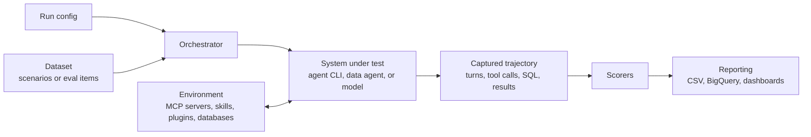

# EvalBench

EvalBench is a framework for evaluating **AI agents**. It runs real agents — coding CLIs such as Gemini CLI, Claude Code, Codex CLI, and Antigravity CLI, as well as conversational data agents — through realistic multi-turn scenarios, captures every turn and tool call, and scores the resulting trajectory for correctness, goal completion, behavior, latency, and cost.

The same pipeline also evaluates **single-turn generation tasks**, most notably **NL2SQL**: generating and executing DQL, DML, and DDL against AlloyDB, BigQuery, Spanner, PostgreSQL, MySQL, SQLite, and more. Agentic and NL2SQL evaluations share one run config format, one scorer framework, and one reporting stack, so you can measure an agent and the model behind it side by side.

Its modular, plug-and-play architecture lets you bring your own agents, tools, datasets, and scorers while reusing a robust evaluation pipeline, result storage, and dashboards.

---

## How it works

Every evaluation — agentic or NL2SQL — follows the same flow:



| Concept | Agentic evaluation | NL2SQL evaluation |
|---|---|---|
| **Dataset** | Scenarios with a `starting_prompt`, `conversation_plan`, and `expected_trajectory` ([format](/docs/configs/agentic-dataset-config.md)) | Eval items with a prompt, golden SQL, and eval queries ([format](/docs/configs/dataset-config.md)) |
| **System under test** | An agent CLI or data agent, selected by `generator` in the [model config](/docs/configs/model-config.md) | A model plus a prompt generator |
| **Environment** | MCP servers, plugins, extensions, skills, or a fake MCP stub — inside a per-run sandbox | One or more [databases](/docs/configs/db-config.md), with optional setup/teardown for DML and DDL |
| **Interaction** | Multi-turn, driven by an LLM-based **simulated user** until the goal is met, a terminal state is reached, or `max_turns` is hit | Single-turn generation and execution; multi-turn interactive variants are available for data agents |
| **Scoring** | Trajectory matching, goal completion, hallucination and clarification behavior, latency, tokens, and cost | Exact/set match, executability, LLM rater, and multi-trial consistency |

Because both share a pipeline, features such as multi-trial runs, LLM judges, BigQuery reporting, and A/B experiment comparison work the same way for either.

---

## What you can evaluate

### Agents

| Agent | Generator | Orchestrator | Guide |
|---|---|---|---|
| Gemini CLI | `gemini_cli` | `agent` / `geminicli` | [Gemini CLI guide](/docs/gemini_cli_agent_testing.md) |
| Claude Code | `claude_code` | `agent` | [Claude Code guide](/docs/claude_code_agent_testing.md) |
| Codex CLI | `codex_cli` | `agent` | [Codex CLI guide](/docs/codex_cli_agent_testing.md) |
| Antigravity (agy) CLI | `agy_cli` | `agent` | [Antigravity CLI guide](/docs/agy_cli_agent_testing.md) |
| Conversational data agents | `dataagent` | `dataagent` / `interact` | [Data agent spec](/docs/dataagent_spec.md) |
| Custom agents over gRPC | `agent_grpc_proxy` | `agent` | [Agentic evaluations](/docs/agentic-evals.md#supported-agents) |

Agents are evaluated against the tools you give them, however those tools are delivered:

- **MCP servers** — remote HTTP/SSE or local stdio Model Context Protocol servers.
- **Plugins** — bundles installed from a git repo or local directory through each CLI's marketplace; may carry skills, MCP servers, or both.
- **Extensions** and **skills** — installed through each CLI's native mechanism.
- **Fake MCP** — a deterministic local stub for fast, offline testing of your harness and datasets without a real tool backend.

Every run is **sandboxed**: agents execute against an isolated home directory, so they never touch your local CLI settings and scenarios can run concurrently. See [Agentic evaluations](/docs/agentic-evals.md) for the execution model, sandboxing, and tool paradigms.

### NL2SQL and other generation tasks

- **NL2SQL** across DQL, DML, and DDL on multiple databases and dialects — see the [database config](/docs/configs/db-config.md) for the supported list.
- **Transform tooling** — compiling and running generated Dataform and dbt projects.
- **Custom tasks** — plug in your own Python scorer for anything else.

---

## Getting started

> *Note*: EvalBench requires Python 3.10 or higher and **uv** for dependency management. Agent evaluations additionally need the relevant CLI's runtime (for example, **Node.js and npm** for Gemini CLI) — see each agent's guide.

### 1. Clone and install

```bash
git clone git@github.com:GoogleCloudPlatform/evalbench.git
cd evalbench
uv venv
source .venv/bin/activate
uv sync
```

### 2. Configure GCP authentication

The bundled examples use Gemini on Vertex AI — for the simulated user, LLM-based scorers, and NL2SQL generation. If gcloud is not installed already, follow the [gcloud installation guide](https://cloud.google.com/sdk/docs/install#installation_instructions), then:

```bash
gcloud auth application-default login

export EVAL_GCP_PROJECT_ID=your_project_id_here
export EVAL_GCP_PROJECT_REGION=your_region_here
```

### 3. Run your first agent evaluation

Start with Gemini CLI against a **fake MCP server**. It exercises the full agentic pipeline — simulated user, tool calls, trajectory capture, and scoring — without a real tool backend:

```bash
export EVAL_CONFIG=datasets/gemini-cli-tools/example_run_fake_config.yaml
./evalbench/run.sh
```

Read through [example_run_fake_config.yaml](/datasets/gemini-cli-tools/example_run_fake_config.yaml) and its [evalset](/datasets/gemini-cli-tools/gemini-cli-fake.evalset.json) to see how scenarios, the model config, and scorers fit together. Results are written to `results/`.

To evaluate a real agent against a real MCP server, switch to one of the ready-to-run configs under [datasets/gemini-cli-tools/](/datasets/gemini-cli-tools/), [datasets/claude-code-tools/](/datasets/claude-code-tools/), [datasets/codex-cli-tools/](/datasets/codex-cli-tools/), or [datasets/agy-cli-tools/](/datasets/agy-cli-tools/). For example:

```bash
export EVAL_CONFIG=datasets/claude-code-tools/example_run_config.yaml
./evalbench/run.sh
```

### 4. Run an NL2SQL evaluation &nbsp;&nbsp;[](https://colab.research.google.com/github/GoogleCloudPlatform/evalbench/blob/main/docs/examples/sqlite_example.ipynb)

The same entry point runs NL2SQL — only the run config changes. This example generates and scores DQL queries against the `db_blog` dataset on a local SQLite database:

```bash
export EVAL_CONFIG=datasets/bat/example_run_config.yaml
./evalbench/run.sh
```

See [example_run_config.yaml](/datasets/bat/example_run_config.yaml) for the dataset, database, generation, and scorer settings used.

---

## Scoring

Scorers are enabled from the `scorers:` block of the run config, and agentic and NL2SQL scorers live in the same catalog. A typical agentic starting set:

```yaml
scorers:
  trajectory_matcher: {}
  turn_count: {}
  end_to_end_latency: {}
  token_consumption: {}
  goal_completion:
    model_config: datasets/model_configs/gemini_2.5_pro_model.yaml
  behavioral_metrics:
    model_config: datasets/model_configs/gemini_2.5_pro_model.yaml
```

| Family | Examples |
|---|---|
| [Agentic](/docs/scorers.md#agentic-scorers) | `trajectory_matcher`, `goal_completion`, `behavioral_metrics`, `parameter_analysis`, `binary_rubric_scorer`, `turn_count`, `agent_steps`, latency and token scorers |
| [Skills](/docs/scorers.md#skills-scorers) | `skills_trajectory`, `skills_best_practices` |
| [SQL](/docs/scorers.md#sql-scorers) | `exact_match`, `set_match`, `executable_sql`, `llmrater` |
| [Multi-trial consistency](/docs/scorers.md#multi-trial-consistency-scorers) | `exact_match_consistency`, `llm_consistency` |
| [Custom](/docs/scorers.md#custom-scorers) | `python_scorer` for your own judges |

LLM-judged scorers can optionally be given [tool access](/docs/judge_tools.md) instead of single-shot prompting.

---

## Reporting and experiments

Results can be stored as CSV or in BigQuery and visualized with built-in dashboards. With BigQuery reporting enabled in the run config, EvalBench supports quickly creating experiments and A/B testing improvements:


Results can be sliced to quantify improvements on specific segments — for example, specific databases or dialects:


You can dig into the exact details of improvements and regressions, including highlighted changes, how they impacted the score, and an LLM-annotated explanation of the scoring changes when an LLM judge is used:


<br><br>

---

## Documentation

Full reference documentation lives in [docs/](/docs/README.md).

| Doc | Contents |
|---|---|
| [Agentic evaluations](/docs/agentic-evals.md) | Execution model, sandboxing, and tool paradigms — start here |
| [Agentic dataset format](/docs/configs/agentic-dataset-config.md) | Scenarios, conversation plans, and expected trajectories |
| [Run config](/docs/configs/run-config.md) | The top-level YAML that drives every evaluation run |
| [Model config](/docs/configs/model-config.md) | Generator and model selection, and generation settings |
| [Scorers](/docs/scorers.md) | Every available scorer and its configuration options |
| [NL2SQL dataset format](/docs/configs/dataset-config.md) | Prompts, golden SQL, and eval queries |
| [Database config](/docs/configs/db-config.md) | Connection details and supported dialects |
| [Examples](/docs/examples/) | Runnable notebooks for SQLite, Cloud SQL, BigQuery, and Agent Runtime |

Contributions are welcome — see [contributing](/docs/contributing.md).
